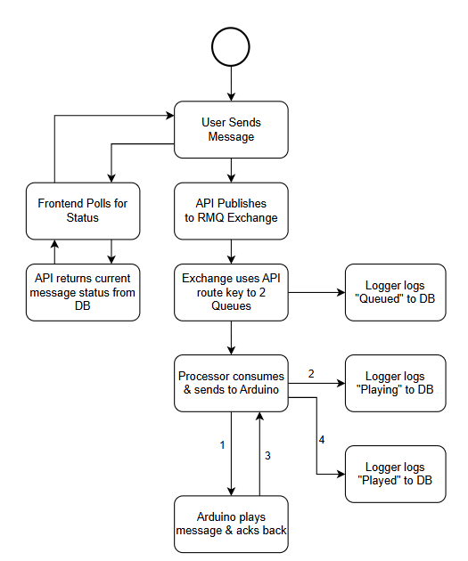
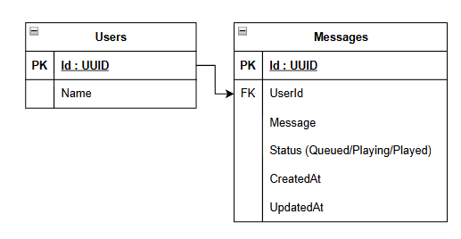

# Morse Code

This is an upgrade of my college IoT project.

## Version 1 (Old)


## Version 2

### Architecture


### Flow chart


### Database Schema


## Setup

```bash
cp .env.example .env
```

```bash
docker compose up -d

docker ps
```